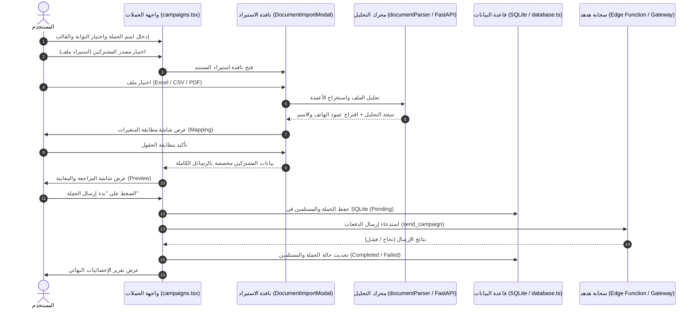

# خطة تجهيز وإرسال حملات الرسائل (Campaign Preparation Plan)

> **النطاق:** مسار استيراد المستندات، استخراج بيانات العملاء، ربط المتغيرات العربية بالقوالب، التحقق من صحة الرسائل، حفظ المستلمين في SQLite، ثم الإرسال الجماعي عبر بوابات هدهد.  
> **الملف البرمجي الرئيسي:** [app/(tabs)/campaigns.tsx](file:///e:/SMS-Smarthoob/app/(tabs)/campaigns.tsx)

---

## 1. مخطط تدفق تجهيز الحملة (Campaign Workflow)

---

## 2. خطوات مسار تجهيز الحملة

### 2.1 الخطوة الأولى: تحديد بيانات الحملة
1. **اسم الحملة**: نص إلزامي مميز للحملة (مثل: "فواتير شهر نوفمبر 2026").
2. **الخدمة المرتبطة (البوابة)**: اختيار البوابة المعتمدة للإرسال (من البوابات المسجلة في الإعدادات).
3. **القالب المعتمد**: اختيار أحد القوالب الجاهزة أو المحفوظة مسبقاً.

### 2.2 الخطوة الثانية: تحديد مصدر المشتركين
يوفر النظام خيارين مرنين:
- **الخيار الأول (الموصى به - استيراد ملف):**
  - يدعم صيغ CSV و XLSX و XLS و PDF.
  - يفتح `DocumentImportModal` لتحليل المستند.
  - يطابق متغيرات القالب (مثل `{{الاسم}}` و `{{المبلغ}}`) بأعمدة الملف.
  - يستخرج أرقام الهواتف تلقائياً وينشئ نص الرسالة النهائي لكل صف.
- **الخيار الثاني (الجلب المباشر من منصة هدهد):**
  - يستعلم مباشرة من خادم البوابة لجلب المشتركين المسجلين في النظام السحابي.

### 2.3 الخطوة الثالثة: مراجعة ومعاينة الحملة (Preview)
قبل خصم أي رصيد أو إرسال أي رسالة، تعرض شاشة المراجعة:
- ملخص الحملة (الاسم، البوابة، القالب، المصدر).
- إجمالي عدد المشتركين المستخرجين.
- **بطاقات معاينة تفاعلية**: تعرض عينات من الرسائل الحقيقية بعد استبدال المتغيرات بالبيانات الفعلية للتأكد من سلامة الصياغة.
- إمكانية الإلغاء أو إعادة الاستيراد في حال وجود خطأ في المطابقة.

### 2.4 الخطوة الرابعة: الإرسال والتسجيل
- عند الضغط على "بدء إرسال الحملة":
  - تُنشأ الحملة في جدول `campaigns` بحالة `sending`.
  - يُدرج جميع المستلمين في جدول `campaign_recipients`.
  - يرسل التطبيق الرسائل مباشرة إلى عنوان البوابة المحدد.
  - تُحدّث العدادات لحظياً ويُعرض تقرير مفصل (إجمالي، نجاح، فشل).

---

## 3. الميزات الذكية في مسار الحملات

### 3.1 الاكتشاف التلقائي للأعمدة (Auto Column Detection)
يتم فحص أول 10 إلى 50 صفاً من الملف للتعرف على طبيعة البيانات:
- **أرقام الهواتف:** التمييز التلقائي للأرقام التي تتطابق مع الأنماط الدولية والمحلية (`+966`, `05xxxxxxxx`, `00966`).
- **الأسماء:** التمييز التلقائي للأعمدة التي تحوي نصوصاً تدل على أسماء العملاء.
- **المبالغ:** تمييز القيم العددية والعملات.

### 3.2 معالجة وتطبيع أرقام الهواتف
- تنظيف الأرقام من المسافات والفواصل والشرطات.
- تصحيح الأرقام التي تبدأ بـ `05` إلى الصيغة الدولية المعيارية للبوابات `9665xxxxxxxx`.
- استبعاد الأرقام غير الصالحة وعرضها في سجل التحذيرات.

### 3.3 الحماية من انقطاع الاتصال (Fault Tolerance)
- بما أن الحملة والمستلمين مسجلون محلياً في SQLite، فإنه في حال انقطاع الشبكة أو إغلاق التطبيق أثناء الإرسال، تبقى بيانات الحملة محفوظة بالكامل مع حالة كل رسالة بدقة.
