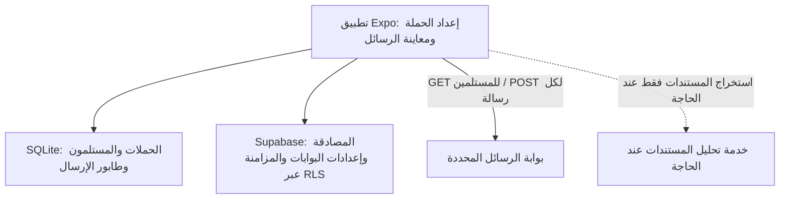

# معمارية تجهيز الحملات والإرسال

## حدود المسؤوليات

تنفذ واجهة التطبيق تجهيز الحملات ومعاينة نصوصها وإدارة حالاتها والإرسال. يتصل التطبيق ببوابة الرسائل مباشرة، بينما يقتصر دور خدمة تحليل المستندات على الحالات التي تحتاج استخراجاً أو تحليلاً غير متاح محلياً. لا ينفذ Supabase Edge Functions إرسال الرسائل أو جلب المستلمين في المسار الحالي.

تُحلل ملفات CSV على الجهاز دون رفعها إلى الخادم. إذا احتوى الملف على عمود رسالة جاهزة، تُستخدم الرسالة كما هي لكل صف؛ وإلا ينشئ التطبيق نص الرسالة من القالب وربط المتغيرات. ملفات Excel وPDF تحتاج خدمة التحليل، ويشترط أن تعيد جميع الصفوف لا عينة منها. يرفض التطبيق إنشاء حملة إذا كانت البيانات جزئية، ولا ينشئ مستلمين افتراضيين أو وهميين.

## دورة الإرسال

1. يتحقق التطبيق من الجلسة، تفعيل الإرسال، البوابة المحددة، ووجود مستلمين.
2. يتحقق من تطابق عدد المستلمين والرسائل وأرقام الهواتف والنصوص ومعرفات الربط، ثم يحفظ الحملة والرسائل الجاهزة في SQLite ضمن معاملة واحدة قبل بدء الإرسال.
3. يقرأ بيانات البوابة من `gateway_connections` باستخدام جلسة المستخدم وسياسات RLS.
4. يرسل الرسائل مباشرة إلى عنوان البوابة على دفعات محددة محلياً. يطبق فاصل الإرسال ومحاولات الإعادة والتأخير التدريجي على الجهاز.
5. يحدث حالة الرسالة في `outgoing_messages` وحالة المستلم المرتبط بها في معاملة SQLite واحدة، ثم يحدث سجل الحملة محلياً ويعرض التقدم للتطبيق.
6. يحجز التطبيق رسائل كل دفعة قبل الإرسال. تبقى الرسالة بحالة `SENDING` خلال محاولات الإعادة كي لا تحجزها عملية أخرى، ولا تعتبر الحملة منتهية ما دامت هناك رسائل قيد الإرسال. يستخدم الهاتف معاملة SQLite حصرية؛ أما الويب فيستخدم معاملة SQLite العادية.
7. تتحدد حالة الحملة من الطابور المحلي: تبقى `sending` إذا كانت هناك رسائل محجوزة، وتصبح `failed` إذا بقيت رسائل معلقة بعد توقف الإرسال كي يمكن استكمالها، وتصبح `completed` عند خلو الطابور من المعلق والمحجوز مع وجود رسائل مرسلة. عند استكمال حملة متوقفة، يحدّث التطبيق حالتها إلى `sending` بعد اجتياز التحقق.
8. تعتمد إتاحة زر الاستكمال على وجود رسائل معلقة وعدم وجود رسائل محجوزة، لا على حالة الحملة المحفوظة؛ وبذلك يمكن استكمال طوابير قديمة حتى لو كان سجل الحملة يحمل `completed`.
9. تمر الرسالة بحالة `CLAIMED` عند حجزها، ثم تنتقل إلى `SENDING` فقط قبل أول طلب للبوابة. مهلة الحجز خمس دقائق وتجدد كل دقيقة أثناء الإرسال. تُستعاد الحجوزات المنتهية عند بدء التطبيق وقبل كل دفعة جديدة، حتى لا تبقى الرسائل غير المرسلة عالقة ما دام التطبيق مفتوحاً. تعاد الحجوزات المنتهية بحالة `CLAIMED` إلى الطابور بأمان، بينما تسجل الحجوزات المنتهية بحالة `SENDING` كفشل ذي نتيجة غير مؤكدة. عند الخطأ، يحرر التطبيق الرسائل التي لم يبدأ طلبها فقط؛ أما الرسائل التي بدأ إرسالها ولم تحفظ نتيجتها فلا تعاد تلقائياً. قبل إعادة الرسائل غير المؤكدة، يعرض التطبيق تأكيداً يطلب مراجعة سجل البوابة لتجنب التكرار. تُعالج الحجوزات المنتهية قبل مزامنة حالة الحملة سحابياً، بينما تبقى الحجوزات الحديثة للعملية النشطة.

يمكن إرسال مستلمين جُلبوا من البوابة برسائلهم الجاهزة دون اختيار قالب. إذا لم يكن للمستلم نص رسالة جاهز، يلزم اختيار قالب؛ ولا يسمح التطبيق ببدء الإرسال مع أي رسالة فارغة.

تُحوّل معرفات القوالب المحلية القديمة غير المتوافقة مع UUID عند فتح قاعدة البيانات، مع تحديث مراجع الحملات وسجل المزامنة المحلي للحفاظ على ارتباطاتها.

## طلبات البوابة

- جلب المشتركين: `GET` إلى عنوان البوابة، مع `Authorization: Bearer <api_key>`.
- إرسال رسالة: `POST` إلى العنوان ذاته بحمولة `{ sender, to, message }`.
- تُعاد استجابة `429` مع احترام ترويسة `Retry-After`.
- تُعامل استجابات `408` و`5xx` كحالات غير مؤكدة ولا يعاد إرسالها تلقائياً؛ فقد تكون البوابة قبلت الرسالة قبل حدوث المهلة أو خطأ الخادم.
- إذا انقطع الاتصال بعد بدء طلب الإرسال، لا يعيد التطبيق الطلب تلقائياً لأن البوابة قد تكون قبلته؛ يصنف النتيجة غير مؤكدة ويطلب مراجعة سجل البوابة قبل الإرسال مجدداً.
- يحدد نجاح HTTP قبول البوابة للطلب، ولا يعني بالضرورة تسليم الرسالة إلى هاتف المستلم.

## ضوابط الأمان والقيود

- تمنع RLS المستخدم من قراءة أو تعديل اتصالات المستخدمين الآخرين.
- يحتاج الإرسال المباشر إلى وصول مفتاح البوابة إلى التطبيق؛ لذلك لا يُعد المفتاح سراً عن مالك الجهاز أو عن نسخة تطبيق معدلة. استخدم مفاتيح محدودة الصلاحية والحصة، ودوّرها عند الاشتباه بكشفها.
- اتصال تطبيق الويب يخضع إلى CORS الذي تفرضه البوابة. لا ينطبق هذا القيد على تطبيقات الهاتف الأصلية.
- لا تضع مفاتيح `service_role` أو أسرار الخادم في تطبيق الهاتف.
- أعيدت دالتا `hoodhad-send` و`gateway-settings` استجابة `410 Gone` لإيقاف مساري الإرسال وإدارة الإعدادات الخادميين بعد نشرهما.
