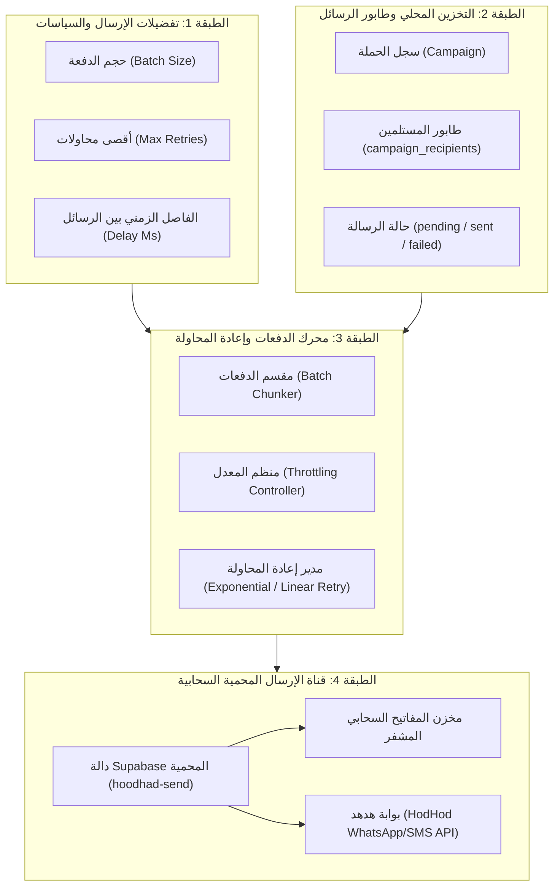
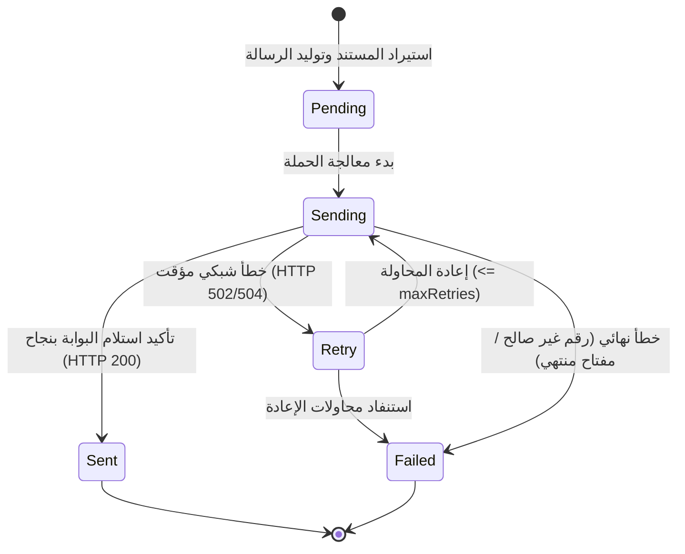

# معمارية الإرسال الجماعي والمزامنة (Delivery & Sync Architecture)

> **النطاق:** معمارية طبقة الإرسال المحمية، إدارة طوابير الرسائل، خوارزميات التحكم في معدل التدفق (Rate Limiting)، سياسات إعادة المحاولة، وحماية المفاتيح السرية.

---

## 1. الطبقات الأربع لمعمارية الإرسال



---

## 2. تفصيل الطبقات

### 2.1 الطبقة 1: تفضيلات الإرسال والسياسات
- تُستخرج الإعدادات من `gatewaySettings.ts`:
  - `batch_size`: عدد الرسائل المعالجة في كل دفعة (الافتراضي 50).
  - `max_retries`: عدد مرات إعادة المحاولة عند حدوث خطأ شبكي (الافتراضي 3).
  - الفاصل الزمني للأمان: تأخير زمني طفيف بين الدفعات لمنع حظر الرقم أو تجاوز الـ Rate Limits.

### 2.2 الطبقة 2: التخزين المحلي وطابور الرسائل (Queue)
- لا يُرسل التطبيق الرسائل مباشرة بشكل عشوائي دون حفظ مسبق.
- **مبدأ الحفظ المسبق (Save-Before-Send):**
  1. يتم حفظ الحملة محلياً في SQLite أولاً.
  2. يتم إدراج جميع المستلمين بنصوص رسائلهم الجاهزة في جدول `campaign_recipients` بحالة `pending`.
  3. يعمل جدول `campaign_recipients` كطابور رسائل (Queue) محلي ومستقل.

### 2.3 الطبقة 3: خوارزمية تقسيم الدفعات وإعادة المحاولة
- يتم تقسيم المستلمين إلى دفعات متتالية:
  ```typescript
  for (let i = 0; i < subscribers.length; i += batchSize) {
    const batch = subscribers.slice(i, i + batchSize);
    // معالجة الدفعة مع المحاولات المتكررة
    for (let attempt = 0; attempt <= maxRetries; attempt++) {
      // إرسال الدفعة وتحديث النتائج
    }
  }
  ```
- في حال تعثر رسالة معينة في الدفعة، لا تتوقف باقي الرسائل؛ يتم تسجيل الخطأ للرسالة الفاشلة فقط والانتقال لما يليها.

### 2.4 الطبقة 4: قناة الإرسال المحمية (Zero-Leakage Gateway Proxy)
- **مبدأ حماية أسرار البوابة:**
  - مفاتيح `api_key` الخاصة بالبوابات لا تصل إلى متصفح الويب أو شفرة الجوال.
  - يستدعي التطبيق دالة `hoodhad-send` مع تمرير معرف الاتصال `connection_id` والمستلمين المخصصين.
  - تستخرج دالة الخادم المفتاح السري بأمان من قاعدة البيانات المصرح بها وتنفذ الطلب عبر بروتوكول TLS المشفر إلى بوابة هدهد.

---

## 3. آلة حالات الرسالة (Message State Machine)



- **`pending`**: الرسالة مجهزة في الطابور المحلي ومحفوظة في قاعدة البيانات.
- **`sending`**: جاري تمرير الرسالة إلى بوابة الإرسال.
- **`sent`**: تم تأكيد قبول الرسالة بنجاح من قبل البوابة مع حفظ توقيت الإرسال `sent_at`.
- **`failed`**: تعذر إرسال الرسالة مع تسجيل نص رسالة الخطأ `error_message` بدقة لمراجعتها لاحقاً أو إعادة إرسالها.
