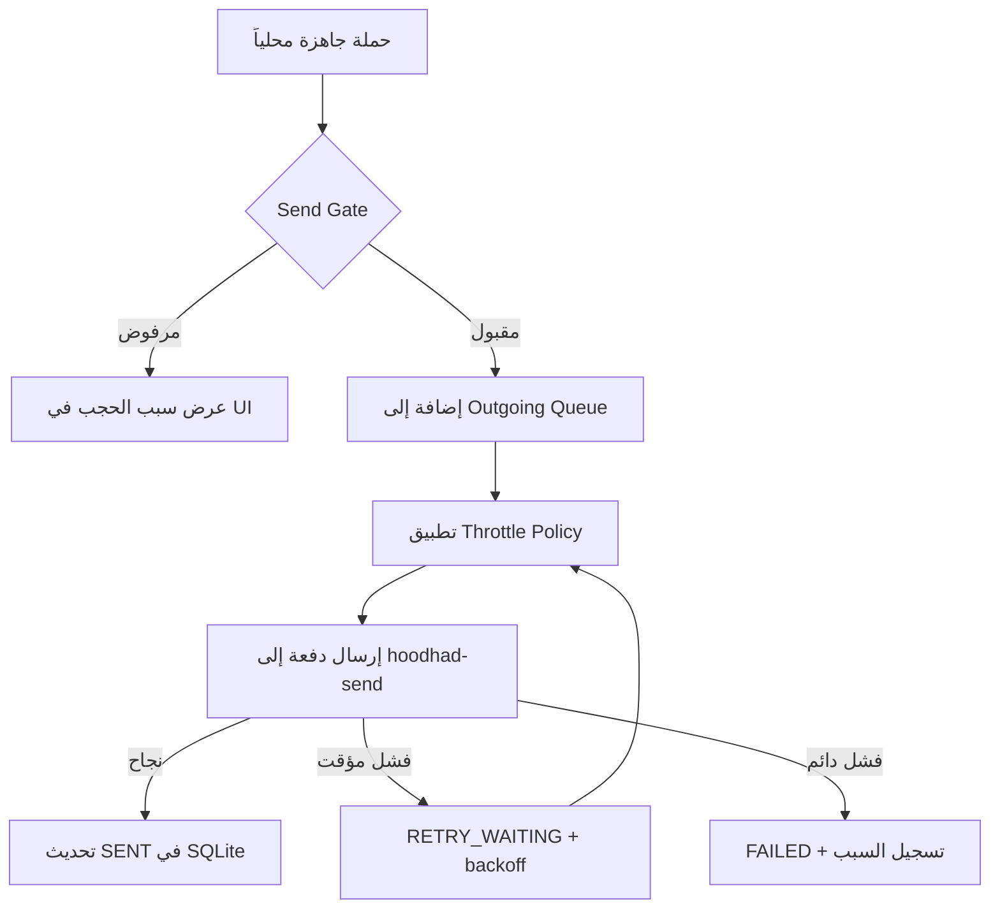
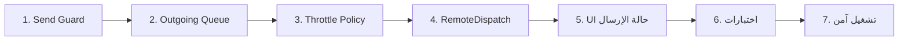

# خطة المرحلة التالية: طبقة الإرسال المحمية

## 1. المقدمة

تهدف هذه المرحلة إلى بناء طبقة إرسال آمنة ومحمية قبل أي تنفيذ فعلي لرفع الحملات أو إرسال الرسائل إلى المنصة. الهدف ليس تشغيل الإرسال مباشرة، بل بناء بنية مؤسسية تضمن:

- اعتماد البوابة النشطة وجلسة Supabase الصالحة فقط
- وجود `gateway_id` محدد وصالح لكل حملة
- التحقق من صحة الاتصال بـ Supabase Edge Functions
- احترام إعدادات throttling وretry
- منع أي إرسال قبل اعتماد عقد المنصة وموثوقية الـ endpoint
- تسجيل كل محاولة بإشارات واضحة مثل `X-Correlation-Id` وHTTP status

يُستند هذا المخطط إلى ما تم تنفيذه فعلياً في:

- `lib/database.ts` — SQLite محلي مع مزامنة Supabase
- `lib/campaigns.ts` — إدارة الحملات (Offline-First)
- `lib/templates.ts` — محرك القوالب وتوليد الرسائل
- `lib/api.ts` — الاتصال بـ FastAPI و Supabase
- `supabase/functions/hoodhad-send/` — دالة Edge الإرسال
- `app/(tabs)/settings.tsx` — إعدادات المزامنة والاتصال

وتبقى الحملات والقوالب في طبقة المعالجة المحلية، بينما الإرسال الحقيقي إلى المنصة يبقى مؤجلاً حتى استيفاء كل الشروط.

---

## 2. الهدف من المرحلة

بناء طبقة تحت اسم **"Send Gate / Outgoing Queue"** تضمن:

1. عدم إرسال أي رسالة إذا لم تكن هناك جلسة Supabase صالحة.
2. عدم إرسال أي رسالة إذا كانت البوابة (`gateway_id`) مفقودة أو غير نشطة.
3. عدم إرسال أي رسالة إذا كان `enableRemoteSend` معطّلاً.
4. تطبيق `delay`, `batchSize`, `maxRetryAttempts`, وtimeouts من إعدادات التطبيق.
5. تطبيق سياسات إعادة المحاولة فقط للأخطاء العابرة.
6. تسجيل كل محاولة بنجاح/فشل/تأخير/مؤشر ارتباط.
7. تمكين الإرسال الحقيقي فقط بعد الموافقة اليدوية من المشغّل.

---

## 3. مخرجات المرحلة

خلال هذه المرحلة سيتم تحقيق ما يلي:



| المخرج | الوصف |
| --- | --- |
| Send Gate | حماية كاملة قبل الإرسال |
| Outgoing Queue (SQLite) | قائمة انتظار محلية للرسائل |
| RequestThrottlePolicy | سياسة موحدة للتأخير وإعادة المحاولة |
| RemoteDispatchService | طبقة batch processing للإرسال |
| حالة الحملة في UI | عرض pending/sent/failed في الوقت الفعلي |
| Feature flag / Kill switch | تعطيل الإرسال افتراضياً مع إمكانية التفعيل |

---

## 4. بنية التنفيذ المقترحة

### 4.1 Gate الحماية (Send Guard)

**الملف:** `lib/sendGuard.ts`

```typescript
export type SendGateStatus =
  | 'APPROVED'
  | 'BLOCKED_NO_SESSION'
  | 'BLOCKED_MISSING_GATEWAY'
  | 'BLOCKED_GATEWAY_DISABLED'
  | 'BLOCKED_FEATURE_DISABLED'
  | 'BLOCKED_INVALID_STATE';

export interface SendGateResult {
  status: SendGateStatus;
  canProceed: boolean;
  detail?: string;
}

export async function evaluateSendGate(
  campaignId: string,
  settings: AppSettings
): Promise<SendGateResult> {
  // يفحص الجلسة → feature flag → البوابة بالترتيب
}
```

المسؤوليات:
- التحقق من وجود جلسة Supabase صالحة (`getSession()`)
- التحقق من تفعيل `enableRemoteSend`
- التحقق من وجود `gateway_id` في الحملة
- التحقق من أن البوابة نشطة في SQLite / Supabase
- إرجاع حالة `APPROVED` أو `BLOCKED_*` مع سبب واضح

النتيجة: لا يمكن تشغيل أي إرسال فعلي إلا إذا كانت الحالة `APPROVED`.

### 4.2 قائمة الانتظار المحلية (Outgoing Queue)

**الجدول:** `outgoing_messages` في SQLite

```sql
CREATE TABLE outgoing_messages (
  id              INTEGER PRIMARY KEY AUTOINCREMENT,
  campaign_id     TEXT    NOT NULL,
  phone           TEXT    NOT NULL,
  message         TEXT    NOT NULL,
  gateway_id      TEXT    NOT NULL,
  status          TEXT    NOT NULL DEFAULT 'PENDING',
  retry_count     INTEGER NOT NULL DEFAULT 0,
  max_retries     INTEGER NOT NULL DEFAULT 3,
  payload_json    TEXT,
  last_error      TEXT,
  correlation_id  TEXT,
  created_at      TEXT    NOT NULL,
  updated_at      TEXT    NOT NULL,
  last_attempt_at TEXT
);
```

الحالات:

| الحالة | المعنى |
| --- | --- |
| `PENDING` | في الانتظار |
| `QUEUED` | مجدولة للإرسال |
| `SENDING` | جارٍ الإرسال الآن |
| `SENT` | تم الإرسال بنجاح |
| `FAILED` | فشل نهائي |
| `RETRY_WAITING` | في انتظار إعادة المحاولة |
| `BLOCKED` | محجوبة بواسطة Send Gate |

المسؤوليات:
- إدخال الرسائل الجاهزة إلى قائمة الانتظار
- جلب الرسائل في حالة `PENDING` فقط
- تحديث الحالة بعد كل محاولة
- منع تكرار التسليم عبر التحقق من `SENDING` عند بدء التطبيق

### 4.3 طبقة Throttling وRetry

**الملف:** `lib/throttlePolicy.ts`

يتم الاعتماد على القيم من `AsyncStorage`:

```typescript
// أولوية التأخير:
// 1. Retry-After من Supabase
// 2. delayBetweenMs من الإعدادات
// 3. Exponential backoff عند الفشل المتكرر

function getEffectiveDelay(
  settings: AppSettings,
  retryCount: number,
  retryAfterHeader?: string
): number {
  const serverDelay = retryAfterHeader ? parseInt(retryAfterHeader) * 1000 : 0;
  const backoff = settings.delayBetweenMs * Math.pow(2, retryCount);
  return Math.max(serverDelay, backoff);
}
```

الحالات القابلة للإعادة:

| الكود | التصنيف |
| --- | --- |
| 429 | قابل للإعادة |
| 502 / 503 / 504 | قابل للإعادة |
| 400 / 401 / 403 / 422 | دائم — لا يُعاد |
| 500 | لا يُعاد إلا إذا موثّق |

### 4.4 طبقة الإرسال إلى المنصة

**الملف:** `lib/remoteDispatch.ts`

المسؤوليات:
- جلب `PENDING` أو `RETRY_WAITING` من قائمة الانتظار
- بناء payload لكل دفعة
- استدعاء `hoodhad-send` Edge Function
- تطبيق delay بين الدفعات
- تحديث حالة الرسالة بناءً على حالة الاستجابة
- تسجيل `httpCode`, `X-Correlation-Id`, `Retry-After`

### 4.5 طبقة التتبع والتسجيل

تُسجَّل كل محاولة في `outgoing_messages` مع:

- `campaignId` و `phone`
- `status` وHTTP code
- `correlationId`
- `retryCount` و `lastError`
- `lastAttemptAt`

---

## 5. تفكيك المرحلة إلى مهام

### المرحلة 1: حماية الإرسال

#### Task 1.1 — إنشاء Send Guard
- إنشاء `lib/sendGuard.ts`
- التحقق من الجلسة والبوابة والـ feature flag
- إرجاع حالة `APPROVED` أو `BLOCKED_*`

#### Task 1.2 — تعطيل زر الإرسال تلقائياً
- إذا كانت الحالة `BLOCKED`، تعطيل الزر مع عرض سبب واضح بالعربية
- عرض أيقونة تحذير مع رسالة توضيحية

#### Task 1.3 — اختبار الوحدة
- حالات: لا جلسة / لا بوابة / بوابة معطّلة / feature flag معطّل / كل الشروط مستوفاة

### المرحلة 2: قائمة انتظار الإرسال المحلية

#### Task 2.1 — تصميم قاعدة البيانات
- إضافة جدول `outgoing_messages` إلى `lib/database.ts`
- إضافة دوال DAO: `insertOutgoing`, `loadPendingBatch`, `updateStatus`, `markBlocked`
- دعم جميع الحالات السبع

#### Task 2.2 — ربط الحملة بقائمة الانتظار
- تحويل مستلمي الحملة إلى عناصر قائمة الانتظار عند بدء الإرسال
- فصل حالة الحملة المحلية عن حالة الإرسال الفعلي

#### Task 2.3 — مسار الاستئناف
- عند بدء التطبيق: تحويل `SENDING` إلى `RETRY_WAITING`
- إعادة محاولة الرسائل الفاشلة القابلة للإعادة فقط

### المرحلة 3: سياسة Throttling

#### Task 3.1 — ربط إعدادات التطبيق
- قراءة `delayBetweenMs`, `batchSize`, `maxRetryAttempts` من `AsyncStorage`
- تطبيقها في `lib/remoteDispatch.ts`

#### Task 3.2 — تنفيذ RequestThrottlePolicy
- تطبيق `calculateDelayMs`
- تطبيق `backoffDelayMs` بناءً على `retryCount`
- احترام `Retry-After` من Supabase

#### Task 3.3 — منع التكرار غير الآمن
- لا تُعاد 401/403/400/422
- لا تُعاد 500 بدون توثيق

### المرحلة 4: التنفيذ الفعلي للإرسال

#### Task 4.1 — بناء Payload
- تجميع رسائل الدفعة مع `phone` و `message`
- إضافة `X-Correlation-Id` فريد لكل دفعة
- إرفاق `gateway_id` و `campaign_id`

#### Task 4.2 — تشغيل Batch Sender
- جلب دفعة من `PENDING`
- إرسال إلى `hoodhad-send` عبر `supabase.functions.invoke`
- تطبيق delay بين الدفعات

#### Task 4.3 — تحويل الاستجابة إلى حالة
- `sent` → `SENT`
- `failed` (عابر) → `RETRY_WAITING`
- `failed` (دائم) → `FAILED`
- `blocked` بواسطة Gate → `BLOCKED`

### المرحلة 5: تتبع حالة الحملة في UI

#### Task 5.1 — شاشة حالة الإرسال
```
الحملة: "عروض رمضان"
─────────────────────────
✅ تم إرسالها:    148
❌ فشل:            2
⏳ في الانتظار:   0
─────────────────────────
آخر خطأ: "Invalid phone number"
آخر محاولة: 2026-11-08 20:00
```

#### Task 5.2 — سجل الحملة
- عرض `correlationId` و`httpCode` وtimestamp لكل دفعة
- إمكانية تصدير السجل

### المرحلة 6: اختبار وسلامة التشغيل

#### Task 6.1 — اختبارات الوحدة
- `SendGuard`: 5 حالات (approve + 4 blocked)
- `RequestThrottlePolicy`: تأخير صحيح, backoff صحيح
- `OutgoingQueue`: insert, update, deduplicate

#### Task 6.2 — اختبارات التكامل
- 429 مع `Retry-After: 5`
- 503 → retry بعد backoff
- 401 → لا retry
- 500 → لا retry

#### Task 6.3 — اختبار Dry-Run
- إرسال لـ 3 أرقام تجريبية حقيقية
- التأكد من استلام الرسائل
- مراجعة السجلات في SQLite

### المرحلة 7: التشغيل الآمن

#### Task 7.1 — Feature Flag
```typescript
const DEFAULT_SETTINGS = {
  enableRemoteSend: false, // يُفعَّل يدوياً من الإعدادات
};
```

#### Task 7.2 — اعتماد رسمي من المشغّل
- لا يُرفع `enableRemoteSend` إلى `true` إلا بعد:
  - اختبار الاتصال بـ Supabase
  - التحقق من صحة البوابة
  - تأكيد نتائج الدفعة التجريبية

#### Task 7.3 — Rollout تدريجي
1. دفعة تجريبية: 10 مستلمين
2. دفعة متوسطة: 100 مستلم
3. الحملة الكاملة بعد التأكيد

---

## 6. معيار القبول النهائي

تُعتبر المرحلة ناجحة فقط إذا تحقق التالي:

| المعيار | الحالة |
| --- | --- |
| لا توجد رسالة تُرسل بدون مرور Send Gate | 🔲 |
| كل رسالة تُخزن أولاً في `outgoing_messages` | 🔲 |
| كل retry يحسب من إعدادات التطبيق و`Retry-After` | 🔲 |
| لا توجد retries غير آمنة (401/403/400) | 🔲 |
| كل دفعة لها `X-Correlation-Id` | 🔲 |
| الرسائل تُحدّث حالتها تلقائياً | 🔲 |
| التشغيل الحقيقي غير مفعّل افتراضياً | 🔲 |
| يمكن استئناف الإرسال بعد إعادة تشغيل التطبيق | 🔲 |

---

## 7. الترتيب العملي للتنفيذ



| الخطوة | الملف | الأولوية |
| --- | --- | --- |
| إنشاء Send Guard | `lib/sendGuard.ts` | عالية جداً |
| إضافة Outgoing Queue | `lib/database.ts` | عالية جداً |
| دمج Throttle Policy | `lib/throttlePolicy.ts` | عالية |
| بناء RemoteDispatch | `lib/remoteDispatch.ts` | عالية |
| عرض الحالة في UI | `app/(tabs)/campaigns.tsx` | متوسطة |
| اختبارات الوحدة | `__tests__/` | متوسطة |
| Rollout آمن | شاشة الإعدادات | نهائية |

---

## 8. مراجعة التغطية

تمت مراجعة هذه الخطة مقابل [SETTINGS-MANAGEMENT-PLAN.md](./SETTINGS-MANAGEMENT-PLAN.md) و[DELIVERY-ARCHITECTURE.md](./DELIVERY-ARCHITECTURE.md):

| البند | مُغطّى؟ |
| --- | --- |
| التحقق من الجلسة والبوابة | ✅ نعم |
| Throttling و`Retry-After` | ✅ نعم |
| Batch size لكل إعداد | ✅ نعم |
| منع الإرسال غير الموثق | ✅ نعم (feature flag) |
| Idempotency ومنع الازدواجية | ✅ نعم (queue + status check) |
| التتبع والمراقبة | ✅ نعم (correlationId + logging) |
| الاعتماد الرسمي قبل الإطلاق | ✅ نعم (manual enable + rollout) |
| فصل البيانات المحلية عن الإرسال | ✅ نعم (campaign ≠ outgoing_messages) |

---

## 9. الخلاصة

المرحلة الحالية تمثل الانتقال من **"تهيئة الحملات والبيانات المحلية"** إلى **"بناء طبقة إرسال محمية وقابلة للقيادة"**. لا يُسمح بالانتقال إلى الإرسال الحقيقي إلا بعد:

- ✅ استيفاء جميع شروط Send Gate
- ✅ اختبار الاتصال بـ Supabase Edge Functions
- ✅ التحقق من صحة البوابة ومعرّفها
- ✅ تأكيد نتائج دفعة اختبارية صغيرة
- ✅ تفعيل `enableRemoteSend` يدوياً من شاشة الإعدادات

وبذلك تظل مجموعات الحملات والقوالب والإعدادات محمية من الإرسال غير الموثق، مع استعداد كامل للمرحلة التشغيلية عند توفر كل الشروط.
