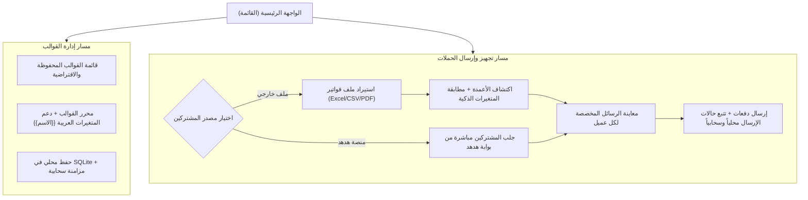

# خطة مشروع تطبيق SMS-Smarthoob (هدهد الفواتير)

> **الهدف:** تطبيق جوال متقدم مبني بـ React Native و Expo، يعمل بنظام **Offline-First** مع قدرات ذكاء اصطناعي وتحليل محلي، لمساعدة المستخدمين والشركات على تجهيز رسائل الفواتير والإشعارات الجماعية من ملفات Excel، CSV، أو PDF، وإرسالها عبر بوابات هدهد (HodHod Gateway Platform) أو الرسائل القصيرة.
>
> **النطاق التقني:** 
> - **إطار العمل:** Expo SDK 57 (React Native 0.86, TypeScript, Expo Router).
> - **التخزين المحلي:** SQLite (عبر `expo-sqlite`) لضمان العمل الكامل بدون إنترنت.
> - **السحابة والمصادقة:** Supabase (Auth, PostgreSQL DB, Edge Functions).
> - **محرك الذكاء الاصطناعي والمعالجة:** خادم محلي Python FastAPI مع دعم التحليل المحلي البديل داخل التطبيق.
> - **اللغة والاتجاه:** لغة عربية كاملة واتجاه من اليمين إلى اليسار (RTL) مع خط Cairo.

---

## 1. فكرة التطبيق والمسارات الرئيسية

تعتمد تجربة الاستخدام في الواجهة الرئيسية على تيسير وصول المشغّل إلى غايته بأقل عدد من الخطوات:

### 1.1 المدخل الأول: الرسائل الجاهزة والمستوردة من الملفات
- يختار المستخدم ملف (Excel / CSV / PDF) يحتوي على أرقام المشتركين وبيانات فواتيرهم.
- يتعرف التطبيق تلقائياً على عمود الهاتف وعمود الاسم والأعمدة المالية.
- يتم تطبيق القالب المختار وتوليد نص الرسالة المخصص لكل صف.

### 1.2 المدخل الثاني: جلب المشتركين من خدمة هدهد المباشرة
- يحدد المستخدم الاتصال المعتمد للبوابة، ويقوم التطبيق بجلب المشتركين المسجلين في البوابة مع مراجعة نصوص الرسائل قبل الإرسال.

---

## 2. مراحل التنفيذ التفصيلية

### المرحلة 1: بنية التطبيق والتخزين المحلي (Offline-First Architecture)
- [x] إعداد مشروع Expo SDK 57 مع هيكل مجلدات يعتمد على Expo Router Tab Navigation.
- [x] تهيئة الخطوط العربية (Cairo) ودعم كامل للـ RTL ونظام ألوان موحد في `constants/theme.ts`.
- [x] بناء محرك SQLite المحلي في `lib/database.ts`:
  - جدول `templates`: لتخزين القوالب والـ 7 قوالب الافتراضية.
  - جدول `campaigns`: لتخزين الحملات ومتابعة عدادات الإرسال (`sent_count`, `failed_count`).
  - جدول `campaign_recipients`: لتخزين بيانات كل مستلم ونص رسالته وحالته.
  - جدول `sync_log`: لتسجيل التغييرات وإدارتها في طابور مزامنة.
- [x] محرك المزامنة الثنائي (Two-way Sync) مع Supabase.

### المرحلة 2: محرك اختيار المستندات والتحليل الذكي (Document Parsing & AI)
- [x] دمج حزمة `expo-document-picker` و `expo-file-system` لاختيار الملفات من ذاكرة الجهاز.
- [x] محرك استخراج محلي `lib/documentParser.ts` لقراءة ملفات CSV واستخراج الأعمدة وتصنيفها دون إنترنت.
- [x] تكامل مع خادم الذكاء الاصطناعي FastAPI في `lib/api.ts` لمعالجة ملفات PDF وملفات Excel المعقدة واستخراج الجداول.
- [x] نافذة استيراد المستندات `components/DocumentImportModal.tsx` لدعم مطابقة المتغيرات التفاعلية وحفظ النتائج.

### المرحلة 3: شاشة تجهيز الحملات والإرسال (Campaigns Flow)
- [x] بناء نموذج الحملة: تحديد الاسم، اختيار البوابة، واختيار القالب.
- [x] إضافة تبويب الاختيار بين استيراد ملف خارجي أو الجلب من البوابة.
- [x] شاشة مراجعة ومعاينة الحملة (`preview`):
  - عرض ملخص الحملة والمصدر وإجمالي المستلمين.
  - بطاقات استعراض نموذجية لكل رسالة معوضة بالقيم الفعلية.
- [x] إرسال الحملة وحفظ السجلات محلياً وفي السحابة.

### المرحلة 4: الإعدادات والتحكم بالبوابات (Settings & Gateway Management)
- [x] إدارة اتصالات البوابات (إضافة، تعديل، حذف، واختبار الاتصال).
- [x] حفظ تفضيلات الإرسال (حجم الدفعة، إعادة المحاولة).
- [x] بطاقة مراقبة المزامنة المحلية وزر المزامنة اليدوية.
- [x] بطاقة إعداد خادم الذكاء الاصطناعي (تحديد عنوان الـ IP وفحص الـ Health Check).

### المرحلة 5: ضبط الأداء والتوافق الشامل
- [x] حل تعارضات إصدارات الحزم وتحديث إعدادات Metro لتضمين WebAssembly.
- [x] فحص الأنظمة البرمجية بنسبة 100% نجاح (`tsc --noEmit`).
- [x] نجاح بناء الويب وتأكيد الجاهزية للمنصات الثلاث (Android, iOS, Web).

---

## 3. القرارات التقنية المحسومة

1. **إلغاء الاعتماد على خادم وسيط في المهام الأساسية**: التطبيق قادر على استعراض القوالب وإعداد الحملات وقراءة ملفات CSV حتى في حال انقطاع الإنترنت التام.
2. **عزل المفاتيح السرية للبوابات**: مفاتيح API الخاصة بالبوابات لا تُخزن مكشوفة في التطبيق، بل يتم إدارتها بصلاحيات محمية عبر دوال Edge Functions.
3. **تطبيع النصوص العربية**: استخراج المتغيرات يدعم الحروف العربية كاملة بصيغة `{{اسم_المتغير}}` مع معالجة المسافات والتطبيع الصوتي للأحرف (أ، إ، آ -> ا).
