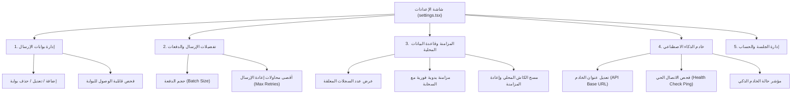

# خطة إدارة الإعدادات والبوابات والمزامنة (Settings Management Plan)

> **النطاق:** إدارة بوابات الإرسال (HodHod Connections)، تفضيلات الإرسال بالدفعات، مراقبة المزامنة المحلية وقاعدة بيانات SQLite، وإعدادات خادم الذكاء الاصطناعي.  
> **الملف البرمجي الرئيسي:** [app/(tabs)/settings.tsx](file:///e:/SMS-Smarthoob/app/(tabs)/settings.tsx)

---

## 1. محاور شاشة الإعدادات

تم تقسيم شاشة الإعدادات إلى 4 أقسام رئيسية مترابطة لتغطية كافة متطلبات تشغيل النظام:

---

## 2. تفاصيل الأقسام البرمجية

### 2.1 إدارة بوابات الإرسال (Gateway Connections)
- **البيانات المطلوبة للبوابة:**
  - `endpoint_url`: رابط نقطة نهاية بوابة هدهد (مثل `https://api.hodhod.example/v1/send`).
  - `sender_name`: اسم المرسل المعتمد لدى البوابة (Sender ID).
  - `api_key`: المفتاح السري للبوابة (يتم تشفيره وإرساله للدوال السحابية ولا يُعرض مكشوفاً).
- **العمليات المتاحة:**
  - عرض قائمة البوابات النشطة وبطاقات كل بوابة.
  - إضافة بوابة جديدة عبر نموذج `ConnectionForm`.
  - تعديل بوابة قائمة أو حذفها.
  - فحص الاتصال التلقائي بالبوابة للتحقق من جاهزيتها.

### 2.2 تفضيلات الإرسال ومعدل التدفق (Batching & Throttling)
- **حجم الدفعة (Batch Size):**
  - النطاق الموصى به: من 10 إلى 200 رسالة في الدفعة الواحدة.
  - الغرض: منع الضغط الزائد على الشبكة والامتثال لحدود مزودي الاتصالات.
- **أقصى عدد محاولات (Max Retries):**
  - من 1 إلى 5 محاولات في حال فشل إرسال رسالة بسبب تعثر مؤقت في الشبكة.

### 2.3 إدارة المزامنة وقاعدة البيانات المحلية (Offline Sync Management)
- **الاستعلام عن السجلات المعلقة:**
  - يقوم التطبيق بالاستعلام عن عدد السجلات في `sync_log` التي تحمل `synced = 0`.
  - عرض شارة ملونة: خضراء (0 سجل معلق - النظام متطابق)، برتقالية (> 0 سجلات معلقة بانتظار المزامنة).
- **المزامنة اليدوية:**
  - زر "مزامنة الآن مع السحابة": يستدعي `database.syncWithSupabase()` لرفع التغييرات المحلية وجلب التحديثات السحابية.
- **إعادة تعيين البيانات المحلية:**
  - زر "مسح المحلي": يتيح للمشغل مسح الجداول المحلية وإعادة استيرادها بالكامل من السحابة دون فقدان أي بيانات سحابية.

### 2.4 إعدادات خادم الذكاء الاصطناعي (AI Backend Configuration)
- **عنوان الخادم (API Base URL):**
  - الافتراضي: `http://10.0.2.2:8000` (لمحاكي الأندرويد) أو `http://localhost:8000` (للويب).
  - يمكن للمستخدم تعديله مباشرة إلى عنوان IP الخاص بجهازه في شبكة Wi-Fi المحلية (مثل `http://192.168.1.50:8000`) لتشغيل الميزات الذكية على الهواتف الحقيقية.
- **فحص الاتصال الحي (Health Check):**
  - زر يرسل طلب `GET /health` للخادم.
  - شارة خضراء تفاعلية "متصل وجاهز" عند نجاح الاتصال، أو شارة رمادية "غير متصل (المحلل المحلي نشط)".
