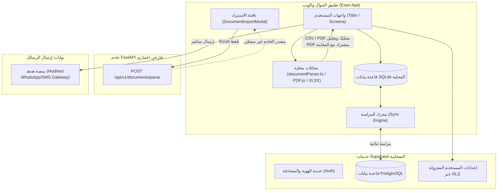
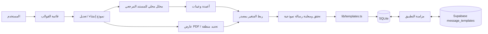

# المواصفات والمعمارية التقنية — نظام SMS-Smarthoob

> **المرجع التقني للمعمارية الحالية ومواصفات تحسين تبويب القوالب**
> **البيئة البرمجية:** TypeScript 5.8 / React 19 / React Native 0.86 / Expo SDK 57
> **التخزين وقواعد البيانات:** SQLite (Expo SQLite) + PostgreSQL (Supabase)
> **تحليل المستندات:** محللات TypeScript محلية + عميل اختياري لخادم FastAPI خارجي لملفات Excel؛ مصدر Python غير مضمّن في المستودع

---

## 1. جدول التقنيات والمكتبات المعتمدة (Technology Stack)

| المكون | التقنية المعتمدة | سبب الاختيار والملاحظات |
|---|---|---|
| **إطار عمل الواجهات** | React Native + Expo (SDK 57) | يوفر كوداً موحداً يعمل على Android و iOS والمتصفحات مع أداء محلي Native عالي. |
| **التوجيه والتنقل** | Expo Router (v57.0) | نظام ملاحة قائم على الملفات (File-based Routing) يدعم علامات التبويب والحماية. |
| **لغة البرمجة** | TypeScript 5.8 | فحص صارم للأنواع البرمجية (Strict Mode) ومنع أخطاء الـ Runtime تماماً. |
| **التخزين المحلي** | Expo SQLite (v58.0) | محرك SQLite محلي متكامل، سريع، ويدعم وضع عدم الاتصال بالإنترنت والـ WASM على الويب. |
| **السحابة وقواعد البيانات** | Supabase (PostgreSQL + RLS) | إدارة التوثيق (Auth)، عزل بيانات المستخدمين (Row Level Security)، والمزامنة السحابية. |
| **إعدادات البوابات والإرسال** | Supabase RLS + Fetch من التطبيق | قراءة إعدادات المستخدم عبر RLS، ثم الاتصال المباشر من التطبيق إلى بوابة الرسائل. |
| **تكامل التحليل المتقدم** | عميل TypeScript لخادم FastAPI قابل للضبط | يستخدمه استيراد الحملات لملفات Excel؛ كود خادم Python خارج هذا المستودع. |
| **المحللات المحلية** | TypeScript + PDF.js + XLSX | قراءة CSV وExcel في نموذج القالب، ومشاركة تحليل PDF ووثيقة النص والإحداثيات بين المعاينة واستيراد الحملات دون رفع الملف. |
| **عرض PDF أصلي** | PDF.js للويب و`react-native-pdf` للجوال | تحديد منطقة البيان على صفحة PDF؛ يتطلب تطبيق الجوال development build بدل Expo Go. |
| **اختيار الملفات** | `expo-document-picker` | اختيار المستندات محلياً مع دعم صلاحيات التخزين على Android و iOS. |
| **إدارة الملفات** | `expo-file-system` | قراءة محتويات الملفات محلياً وتحويلها للمصفوفات والبيانات الثنائية. |
| **الخطوط والسمات** | Google Cairo Fonts (`@expo-google-fonts/cairo`) | خط عربي أصيل يدعم جميع الأوزان (Regular, SemiBold, Bold) متناسق مع اتجاه RTL. |

---

## 2. مخطط معمارية النظام (System Architecture)



---

## 3. مخطط قاعدة البيانات المحلية (Local SQLite Schema)

تم بناء قاعدة البيانات محلياً في ملف `smarthoop.db` بالجداول التالية:

### 3.1 جدول القوالب (`templates`)
```sql
CREATE TABLE IF NOT EXISTS templates (
  id TEXT PRIMARY KEY,
  title TEXT NOT NULL,
  body TEXT NOT NULL,
  variable_mappings TEXT NOT NULL DEFAULT '{}',
  user_id TEXT NOT NULL,
  is_default INTEGER DEFAULT 0,
  created_at TEXT NOT NULL,
  updated_at TEXT NOT NULL,
  sync_status TEXT DEFAULT 'pending' -- ('synced', 'pending', 'conflict')
);
```

### 3.2 جدول الحملات (`campaigns`)
```sql
CREATE TABLE IF NOT EXISTS campaigns (
  id TEXT PRIMARY KEY,
  name TEXT NOT NULL,
  template_id TEXT,
  connection_id TEXT,
  status TEXT DEFAULT 'draft',       -- ('draft', 'preparing', 'sending', 'completed', 'failed')
  total_recipients INTEGER DEFAULT 0,
  sent_count INTEGER DEFAULT 0,
  failed_count INTEGER DEFAULT 0,
  user_id TEXT NOT NULL,
  created_at TEXT NOT NULL,
  updated_at TEXT NOT NULL,
  sync_status TEXT DEFAULT 'pending'
);
```

### 3.3 جدول مستلمي الحملات (`campaign_recipients`)
```sql
CREATE TABLE IF NOT EXISTS campaign_recipients (
  id TEXT PRIMARY KEY,
  campaign_id TEXT NOT NULL,
  subscriber_phone TEXT NOT NULL,
  subscriber_name TEXT NOT NULL,
  message_body TEXT NOT NULL,
  status TEXT DEFAULT 'pending',     -- ('pending', 'sent', 'failed', 'skipped')
  sent_at TEXT,
  error_message TEXT,
  sync_status TEXT DEFAULT 'pending',
  FOREIGN KEY (campaign_id) REFERENCES campaigns (id) ON DELETE CASCADE
);
```

### 3.4 جدول اتصالات البوابات (`gateway_connections`)
```sql
CREATE TABLE IF NOT EXISTS gateway_connections (
  id TEXT PRIMARY KEY,
  name TEXT NOT NULL,
  api_key TEXT,
  provider TEXT DEFAULT 'hodhod',
  user_id TEXT NOT NULL,
  created_at TEXT NOT NULL,
  updated_at TEXT NOT NULL,
  sync_status TEXT DEFAULT 'synced'
);
```

### 3.5 جدول سجل المزامنة (`sync_log`)
```sql
CREATE TABLE IF NOT EXISTS sync_log (
  id INTEGER PRIMARY KEY AUTOINCREMENT,
  table_name TEXT NOT NULL,
  record_id TEXT NOT NULL,
  action TEXT NOT NULL,              -- ('create', 'update', 'delete')
  timestamp TEXT NOT NULL,
  synced INTEGER DEFAULT 0
);
```

---

## 4. محرك القوالب والوسوم (Template Engine)

- **صيغة المتغيرات:** `{{اسم_المتغير}}` (تدعم الحروف العربية والإنجليزية والأرقام والشرطة السفلية).
- **خوارزمية الاستخراج والتوليد:**
  ```typescript
  // استخراج المتغيرات
  export function extractPlaceholders(body: string): string[] {
    const matches = body.matchAll(/\{\{\s*([\w\u0600-\u06FF\u0750-\u077F]+)\s*\}\}/g);
    return Array.from(new Set(Array.from(matches, m => m[1])));
  }

  // توليد الرسالة المخصصة
  export function renderMessage(templateBody: string, data: Record<string, string>): string {
    return templateBody.replace(/\{\{\s*([\w\u0600-\u06FF\u0750-\u077F]+)\s*\}\}/g, (_, key) => {
      return data[key] !== undefined ? data[key] : '';
    });
  }
  ```

---

## 5. مواصفات خادم الذكاء الاصطناعي (FastAPI API Contracts)

- يستدعي التطبيق نقطة التحليل التالية لملفات Excel في استيراد الحملات فقط؛ لا يعني دعم الخادم لأنواع أخرى أن التطبيق يرفع CSV أو PDF إليه.
- **`POST /api/v1/documents/parse`**:
  - المدخل: `file: UploadFile` (CSV, XLSX, PDF).
  - المخرج:
    ```json
    {
      "success": true,
      "data": {
        "columns": ["اسم_العميل", "رقم_الجوال", "المبلغ_المستحق"],
        "row_count": 150,
        "suggested_phone_column": "رقم_الجوال",
        "suggested_name_column": "اسم_العميل",
        "detected_fields": [
          { "column_name": "رقم_الجوال", "detected_type": "phone", "confidence": 0.98 }
        ],
        "sample_data": [...]
      }
    }
    ```
- **`POST /api/v1/ai/suggest-template`**:
  - اقتراح القالب المناسب بناءً على أعمدة الملف المكتشفة.
- **`POST /api/v1/ai/auto-link`**:
  - ربط تلقائي فوري بين متغيرات القالب وأعمدة الملف.

---

## 6. معمارية تبويب القوالب

> **حدود هذا القسم:** يصف مسار إنشاء القالب وإدارته ومعاينته. لا يشمل مطابقة قالب بمستند حملة أو توليد رسائل المستلمين أو الإرسال.

### 6.1 مكونات المسار

| المكون | المسؤولية |
|---|---|
| `app/(tabs)/templates.tsx` | عرض قائمة القوالب وحالاتها وفتح تدفق الإنشاء أو التعديل. |
| `components/TemplateForm.tsx` | إدارة اسم القالب ونصه، قراءة المستند المرجعي محليًا، إنشاء البنود والربطات، والتحقق قبل الحفظ. |
| `lib/documentParser.ts` | تحليل المستند المرجعي محليًا، وتحليل PDF مع وثيقة النص المشتركة لإظهار الحقول المقترحة والعينات. |
| `components/PdfRegionSelector.tsx` | عرض وثيقة PDF نفسها، واختيار استخراج قيمة لكل صفحة أو قيمة لكل صف، وإرجاع المنطقة وعينات القيم. |
| `lib/templateMappings.ts` | تعريف أنواع ربط المتغيرات والتحقق من صلاحية الربط ومنطقة PDF. |
| `lib/templates.ts` | جلب القوالب وإنشاؤها وتحديثها وحذفها، واستخراج المتغيرات وعرض الرسالة. |
| `lib/database.ts` | تخزين القوالب والربطات في SQLite ومزامنتها مع Supabase. |



### 6.2 حدود الاتصال والتحليل

- يستدعي نموذج القالب `pickDocument()` و`parseDocumentFile()` للمستندات غير PDF، ويستخدم `analyzePdfDocument()` لقراءة PDF ووثيقة النص التي تشاركها المعاينة.
- لا يستدعي تدفق إنشاء القالب FastAPI ولا يرفع المستند المرجعي إلى خادم تحليل.
- يستورد `DocumentImportModal` ملف PDF عبر المحلل المحلي نفسه ويطبق عليه الربطات المحفوظة؛ يظل FastAPI مستخدمًا لملفات Excel فقط.
- لا تُضاف نقطة API جديدة ولا يضاف خادم Python لهذا النطاق.
- اختيار مستند مرجعي في نموذج القالب هو خطوة تعريف للمصادر، وليس استيراد حملة أو مطابقة تلقائية لمستند قادم.

## 7. نموذج البيانات وعقد الربطات

### 7.1 نموذج TypeScript

يتكون الربط من مفتاح يطابق اسم المتغير في نص القالب، وقيمة تمثل نوع المصدر وبياناته:

```typescript
type PdfRegion = {
  left: number;
  top: number;
  right: number;
  bottom: number;
  scope?: 'page' | 'rows';
};

type TemplateVariableMapping =
  | { type: 'column'; column: string }
  | { type: 'pdf-region'; region: PdfRegion };

type TemplateVariableMappings = Record<string, TemplateVariableMapping>;
```

قواعد التحقق المطبقة في `isTemplateVariableMappings`:

- يجب أن يكون كائن الربطات كائنًا لا مصفوفة.
- اسم المتغير غير فارغ.
- مصدر العمود من النوع `column` واسم العمود غير فارغ.
- إحداثيات منطقة PDF أرقام منتهية بين 0 و1.
- يجب تحقق `left < right` و`top < bottom`.
- `scope: 'page'` يقرأ قيمة من الموضع المحدد في كل صفحة، وهو النمط الافتراضي للربطات القديمة. `scope: 'rows'` يقرأ قيمة من كل سطر يقع داخل النطاق الرأسي، ومن الجزء الأفقي المحدد للعمود.
- يمكن الجمع بين ربط صفوف PDF وحقول الأعمدة المستخرجة آليًا؛ تُكرر قيمة العمود على كل سجل من الصفحة نفسها، بينما تستخرج المناطق ذات `scope: 'rows'` قيمة مستقلة لكل صف. اختيار نص من القائمة في نمط الصفوف لا يعتمد النطاق، بل يلزم سحب صفوف البيانات صراحةً.
- يرفض محلل الربطات قيمة لا تطابق العقد بدل استخدامها كربط صحيح.

### 7.2 التخزين المحلي والسحابي

- SQLite: يخزن عمود `templates.variable_mappings` قيمة JSON نصية، وقيمته الافتراضية `{}`.
- Supabase: يخزن عمود `message_templates.variable_mappings` قيمة `jsonb` غير فارغة، وقيمته الافتراضية `{}`.
- إضافة العمود السحابي معرفة في [ترحيل ربط متغيرات القوالب](../supabase/migrations/20261123200000_add_template_variable_mappings.sql).
- يتضمن نموذج `MessageTemplate` الربطات بعد فك ترميزها إلى `TemplateVariableMappings`؛ أما نموذج SQLite فيخزنها كسلسلة JSON.
- لا يلزم عمود جاهزية جديد إذا أمكن اشتقاق الحالة من نص القالب والربطات. تحفظ المسودة بالقيم الموجودة، وتعرض الواجهة حالتها المحسوبة.
- يجب أن تبقى السجلات القديمة ذات الربطات الفارغة `{}` قابلة للقراءة والتعديل.

## 8. عقد معالجة القالب والتحقق

### 8.1 المتغيرات

- صيغة المتغير `{{اسم_المتغير}}`.
- يدعم الاستخراج الأحرف العربية والإنجليزية والأرقام والشرطة السفلية، ويعيد قائمة أسماء فريدة مع المحافظة على ترتيب الظهور.
- حد الاسم في النموذج الحالي 100 حرف، وحد نص الرسالة 1000 حرف.
- يتيح النموذج إدراج المتغير عند موضع المؤشر، ويمكن تسمية البند يدويًا.
- عند الحفظ الحالي، تُحفظ الربطات الخاصة بالمتغيرات المستخدمة في نص الرسالة فقط.

### 8.2 حالة الجاهزية المستهدفة

تحسب حالة القالب من النص والربطات دون تخزين علم جاهزية منفصل:

1. **غير مكتمل:** اسم أو نص مطلوب مفقود، أو متغير مستخدم بلا ربط صالح.
2. **جاهز:** الاسم والنص صالحان، وكل متغير مستخدم له مصدر صحيح، وتعرض المعاينة أي حدود في العينة بوضوح.

يمكن حفظ القالب غير المكتمل كمسودة بحسب متطلبات المنتج، لكن يجب ألا يظهر في الواجهة على أنه جاهز. ينبغي على المعاينة إظهار القيم غير المتاحة بوضوح، حتى مع أن `renderMessage` الحالي يحول المتغير الذي لا توجد له قيمة في `data` إلى سلسلة فارغة. ولا يغير ذلك سلوك مسارات الحملات ضمن هذه الوثيقة.

## 9. الحفظ والمزامنة ومعالجة الأخطاء

- المسار المعتاد يبدأ بالتخزين المحلي في SQLite، ثم يطلب مزامنة Supabase في الخلفية عند وجود مستخدم مصادق عليه.
- تتعامل طبقة القوالب مع فك ترميز `variable_mappings` وتتحقق من بنيته قبل إرجاعه للواجهة.
- يحافظ النموذج على خطأ القراءة أو التحقق أو الحفظ في واجهة النموذج، ولا يغلق النموذج قبل نجاح عملية الإنشاء أو التعديل المحلية.
- **فجوة ينبغي أخذها في الاعتبار:** المزامنة الخلفية الحالية تسجل بعض الأخطاء في السجل، ولا تعرض بالضرورة نتيجتها النهائية داخل نموذج القالب. إذا كان المطلوب أن يعرف المستخدم نتيجة المزامنة السحابية تحديدًا، فيلزم توفير حالة مزامنة قابلة للملاحظة للواجهة بدل الاكتفاء بتسجيل الخطأ.
- لا تُستخدم قيمة افتراضية ناجحة عند فساد JSON للربطات؛ يجب رفضها وعرض خطأ مفهوم أو تسجيل فشل قابل للتتبع.

## 10. التوافق والمنصات

- يعتمد تحليل الملف المرجعي على محللات TypeScript الموجودة في التطبيق. PDF في المعاينة واستيراد الحملات يستخدم وثيقة النص والإحداثيات المشتركة نفسها.
- اختيار مناطق PDF يعتمد على عارض مختلف بحسب المنصة؛ يجب الحفاظ على نفس معنى الإحداثيات النسبية في ناتج الاختيار والتحقق من النتيجة على الويب وAndroid وiOS.
- العارض الأصلي للجوال يتطلب development build؛ يجب ألا يُفترض أن اختبار PDF على Expo Go يثبت عمل النسخة الأصلية.
- يجب ألا تتغير بنية الربطات أو تفسيرها باختلاف المنصة.

## 11. خطة التحقق التقنية

- **وحدات:** استخراج المتغيرات، الأسماء العربية، تكرار المتغير، صحة أنواع الربط، حدود إحداثيات PDF، ومحاذاة قيم الصفوف والصفحات.
- **تكامل التخزين:** إنشاء/تعديل/تحميل القالب مع ربطات الأعمدة ومناطق PDF على SQLite وSupabase.
- **التوافق الخلفي:** قراءة قالب قديم بلا عمود ربط أو بقيمة `{}`، دون فقد الاسم أو النص.
- **اختبارات واجهة:** مدخلات غير صالحة، مصدر غير محدد، عينة فارغة، فشل قراءة ملف، فشل حفظ، وتعديل ملغى.
- **منصات:** قائمة القوالب والنموذج على الويب وAndroid وiOS، مع اختبار عارض PDF الأصلي في development build.
- **حدود النطاق:** التحقق من أن إنشاء القالب لا يستدعي FastAPI ولا يضيف سلوك استيراد أو مطابقة أو إرسال.

## 12. الملفات المرجعية

- [متطلبات النظام ومتطلبات تبويب القوالب](./TECHNICAL-REQUIREMENTS.md)
- [خطة تحسين تبويب القوالب](./TEMPLATES-IMPROVEMENT-PLAN.md)
- [دليل التنفيذ](./TEMPLATES-IMPLEMENTATION-GUIDE.md)
- [خطة الاختبار](./TEMPLATES-TEST-PLAN.md)
- [واجهة القوالب](../app/(tabs)/templates.tsx)
- [نموذج القالب](../components/TemplateForm.tsx)
- [عارض PDF واختيار المنطقة](../components/PdfRegionSelector.tsx)
- [أنواع ربط المتغيرات](../lib/templateMappings.ts)
- [خدمات القوالب](../lib/templates.ts)
- [تخزين التطبيق ومزامنته](../lib/database.ts)
