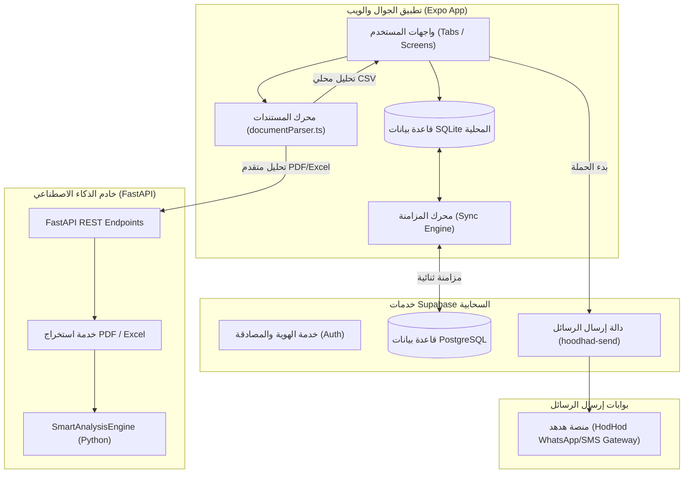

# المواصفات والمعمارية التقنية — نظام SMS-Smarthoob

> **المرجع التقني المعتمد للمشروع**  
> **البيئة البرمجية:** TypeScript 5.8 / React 19 / React Native 0.86 / Expo SDK 57  
> **التخزين وقواعد البيانات:** SQLite (Expo SQLite) + PostgreSQL (Supabase)  
> **خدمات الذكاء الاصطناعي:** Python FastAPI + Local TS Heuristic Engine

---

## 1. جدول التقنيات والمكتبات المعتمدة (Technology Stack)

| المكون | التقنية المعتمدة | سبب الاختيار والملاحظات |
|---|---|---|
| **إطار عمل الواجهات** | React Native + Expo (SDK 57) | يوفر كوداً موحداً يعمل على Android و iOS والمتصفحات مع أداء محلي Native عالي. |
| **التوجيه والتنقل** | Expo Router (v57.0) | نظام ملاحة قائم على الملفات (File-based Routing) يدعم علامات التبويب والحماية. |
| **لغة البرمجة** | TypeScript 5.8 | فحص صارم للأنواع البرمجية (Strict Mode) ومنع أخطاء الـ Runtime تماماً. |
| **التخزين المحلي** | Expo SQLite (v58.0) | محرك SQLite محلي متكامل، سريع، ويدعم وضع عدم الاتصال بالإنترنت والـ WASM على الويب. |
| **السحابة وقواعد البيانات** | Supabase (PostgreSQL + RLS) | إدارة التوثيق (Auth)، عزل بيانات المستخدمين (Row Level Security)، والمزامنة السحابية. |
| **المهام السحابية الخفية** | Supabase Edge Functions (Deno) | تشغيل مهام الإرسال `hoodhad-send` وإدارة البوابات دون كشف المفاتيح للعميل. |
| **محرك الذكاء الاصطناعي** | Python FastAPI Backend | محرك ذكي متخصص في استخراج الجداول من PDF/Excel ومطابقة الحقول باللغة العربية. |
| **المحلل المحلي** | TypeScript Heuristic Parser | محلل خفيف داخل التطبيق لقراءة ملفات CSV وتحليل الأعمدة أوفلاين دون الحاجة لأي خادم. |
| **اختيار الملفات** | `expo-document-picker` | اختيار المستندات محلياً مع دعم صلاحيات التخزين على Android و iOS. |
| **إدارة الملفات** | `expo-file-system` | قراءة محتويات الملفات محلياً وتحويلها للمصفوفات والبيانات الثنائية. |
| **الخطوط والسمات** | Google Cairo Fonts (`@expo-google-fonts/cairo`) | خط عربي أصيل يدعم جميع الأوزان (Regular, SemiBold, Bold) متناسق مع اتجاه RTL. |

---

## 2. مخطط معمارية النظام (System Architecture)



---

## 3. مخطط قاعدة البيانات المحلية (Local SQLite Schema)

تم بناء قاعدة البيانات محلياً في ملف `smarthoop.db` بالجداول التالية:

### 3.1 جدول القوالب (`templates`)
```sql
CREATE TABLE IF NOT EXISTS templates (
  id TEXT PRIMARY KEY,
  title TEXT NOT NULL,
  body TEXT NOT NULL,
  user_id TEXT NOT NULL,
  is_default INTEGER DEFAULT 0,
  created_at TEXT NOT NULL,
  updated_at TEXT NOT NULL,
  sync_status TEXT DEFAULT 'pending' -- ('synced', 'pending', 'conflict')
);
```

### 3.2 جدول الحملات (`campaigns`)
```sql
CREATE TABLE IF NOT EXISTS campaigns (
  id TEXT PRIMARY KEY,
  name TEXT NOT NULL,
  template_id TEXT,
  connection_id TEXT,
  status TEXT DEFAULT 'draft',       -- ('draft', 'preparing', 'sending', 'completed', 'failed')
  total_recipients INTEGER DEFAULT 0,
  sent_count INTEGER DEFAULT 0,
  failed_count INTEGER DEFAULT 0,
  user_id TEXT NOT NULL,
  created_at TEXT NOT NULL,
  updated_at TEXT NOT NULL,
  sync_status TEXT DEFAULT 'pending'
);
```

### 3.3 جدول مستلمي الحملات (`campaign_recipients`)
```sql
CREATE TABLE IF NOT EXISTS campaign_recipients (
  id TEXT PRIMARY KEY,
  campaign_id TEXT NOT NULL,
  subscriber_phone TEXT NOT NULL,
  subscriber_name TEXT NOT NULL,
  message_body TEXT NOT NULL,
  status TEXT DEFAULT 'pending',     -- ('pending', 'sent', 'failed', 'skipped')
  sent_at TEXT,
  error_message TEXT,
  sync_status TEXT DEFAULT 'pending',
  FOREIGN KEY (campaign_id) REFERENCES campaigns (id) ON DELETE CASCADE
);
```

### 3.4 جدول اتصالات البوابات (`gateway_connections`)
```sql
CREATE TABLE IF NOT EXISTS gateway_connections (
  id TEXT PRIMARY KEY,
  name TEXT NOT NULL,
  api_key TEXT,
  provider TEXT DEFAULT 'hodhod',
  user_id TEXT NOT NULL,
  created_at TEXT NOT NULL,
  updated_at TEXT NOT NULL,
  sync_status TEXT DEFAULT 'synced'
);
```

### 3.5 جدول سجل المزامنة (`sync_log`)
```sql
CREATE TABLE IF NOT EXISTS sync_log (
  id INTEGER PRIMARY KEY AUTOINCREMENT,
  table_name TEXT NOT NULL,
  record_id TEXT NOT NULL,
  action TEXT NOT NULL,              -- ('create', 'update', 'delete')
  timestamp TEXT NOT NULL,
  synced INTEGER DEFAULT 0
);
```

---

## 4. محرك القوالب والوسوم (Template Engine)

- **صيغة المتغيرات:** `{{اسم_المتغير}}` (تدعم الحروف العربية والإنجليزية والأرقام والشرطة السفلية).
- **خوارزمية الاستخراج والتوليد:**
  ```typescript
  // استخراج المتغيرات
  export function extractPlaceholders(body: string): string[] {
    const matches = body.matchAll(/\{\{\s*([\w\u0600-\u06FF\u0750-\u077F]+)\s*\}\}/g);
    return Array.from(new Set(Array.from(matches, m => m[1])));
  }

  // توليد الرسالة المخصصة
  export function renderMessage(templateBody: string, data: Record<string, string>): string {
    return templateBody.replace(/\{\{\s*([\w\u0600-\u06FF\u0750-\u077F]+)\s*\}\}/g, (_, key) => {
      return data[key] !== undefined ? data[key] : '';
    });
  }
  ```

---

## 5. مواصفات خادم الذكاء الاصطناعي (FastAPI API Contracts)

- **`POST /api/v1/documents/parse`**:
  - المدخل: `file: UploadFile` (CSV, XLSX, PDF).
  - المخرج:
    ```json
    {
      "success": true,
      "data": {
        "columns": ["اسم_العميل", "رقم_الجوال", "المبلغ_المستحق"],
        "row_count": 150,
        "suggested_phone_column": "رقم_الجوال",
        "suggested_name_column": "اسم_العميل",
        "detected_fields": [
          { "column_name": "رقم_الجوال", "detected_type": "phone", "confidence": 0.98 }
        ],
        "sample_data": [...]
      }
    }
    ```
- **`POST /api/v1/ai/suggest-template`**:
  - اقتراح القالب المناسب بناءً على أعمدة الملف المكتشفة.
- **`POST /api/v1/ai/auto-link`**:
  - ربط تلقائي فوري بين متغيرات القالب وأعمدة الملف.
